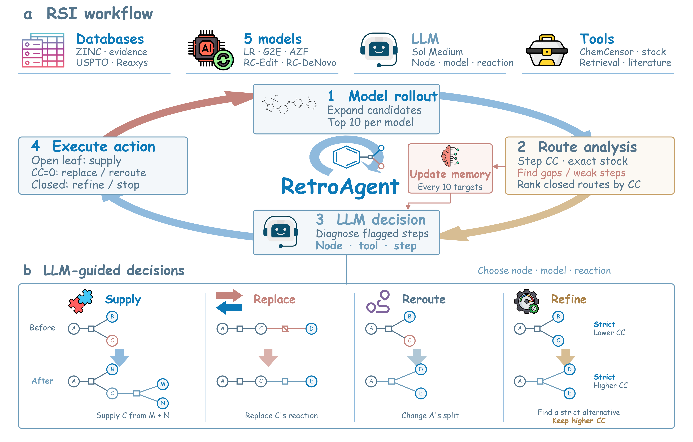
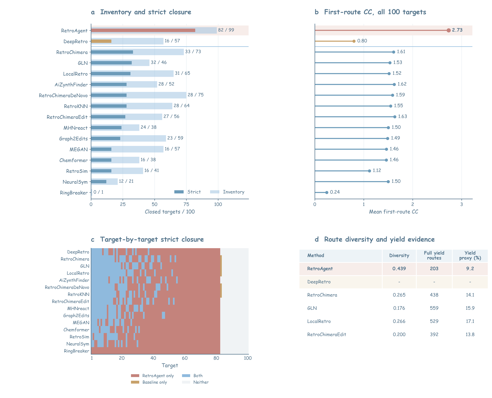
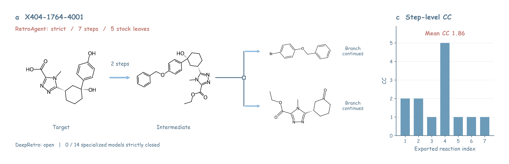
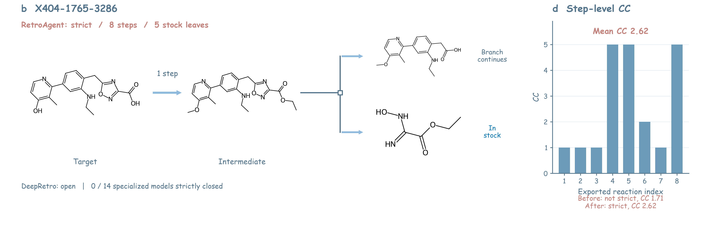
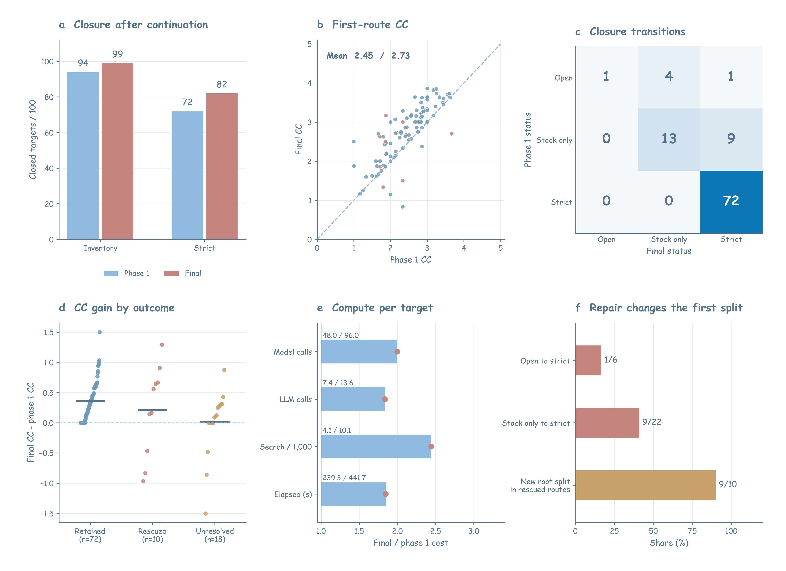

# RetroAgent

**Recursive self-improvement for multistep retrosynthesis**

RetroAgent takes a target SMILES and searches for a synthesis route whose starting materials are in stock and whose reactions have positive ChemCensor (CC) support. Specialist models propose reactions. Inventory and CC checks identify the bottleneck. The LLM chooses the backtrack node, model and reaction; the controller executes the repair and checks the resulting route again. Outcome memory updates between batches of ten targets and informs subsequent repair decisions.

<p align="center"></p>

## Results

On the same 100 targets, RetroAgent reaches **99% inventory closure**, **82% strict closure** and **2.7349 mean first-route CC**. The comparison includes pure LLM baselines (6.1 Sol and 6.2 Astra), the MCTS variant, DeepRetro from its author repository, and 14 specialized-model baselines.

| Method | Inventory closure | Strict closure | First-route CC |
| :--- | ---: | ---: | ---: |
| **RetroAgent** | **99%** | **82%** | **2.7349** |
| RetroAgent (MCTS) | 83% | 65% | 2.6096 |
| Pure LLM (6.1 Sol) | 10% | 3% | 0.9857 |
| Pure LLM (6.2 Astra) | 16% | 5% | 1.0199 |
| DeepRetro | 57% | 16% | 0.8002 |
| RetroChimera | 73% | 33% | 1.6107 |
| GLN | 46% | 32% | 1.5349 |
| LocalRetro | 65% | 31% | 1.5185 |
| AiZynthFinder | 52% | 28% | 1.6236 |
| RetroChimeraDeNovo | 75% | 28% | 1.5886 |
| RetroKNN | 64% | 28% | 1.5506 |
| RetroChimeraEdit | 56% | 27% | 1.6347 |
| MHNreact | 38% | 24% | 1.5030 |
| Graph2Edits | 59% | 23% | 1.4883 |
| MEGAN | 57% | 16% | 1.4630 |
| Chemformer | 38% | 16% | 1.4620 |
| RetroSim | 41% | 16% | 1.1169 |
| NeuralSym | 21% | 12% | 1.5001 |
| RingBreaker | 1% | 0% | 0.2433 |

<p align="center"></p>

[Complete results](benchmark/RESULTS.md) · [Comparison CSV](benchmark/comparison.csv) · [Metric definitions](benchmark/PROTOCOL.md) · [Figure captions](figures/CAPTIONS.md)

## Two route examples

### X404-1764-4001

RetroAgent finds a **7-reaction, strictly closed route** with **5 stock leaves** and mean CC **1.8571**. Every selected reaction has positive CC. DeepRetro remains open; none of the 14 specialized models reaches strict closure on this target.



[Target SMILES, selected reactions, stock leaves and per-step CC](examples/X404-1764-4001/route.json)

### X404-1765-3286

The first phase has stock closure but contains a CC-zero reaction. Continuation produces an **8-reaction strictly closed route**, with **5 stock leaves**, and increases mean CC from **1.7143 to 2.6250**. DeepRetro remains open; none of the 14 specialized models reaches strict closure on this target.



[Target SMILES, selected reactions, stock leaves and per-step CC](examples/X404-1765-3286/route.json)

## Install and run

The controller runs on Linux with Python 3.12. Chemistry models and databases are served separately.

```bash
python -m venv .venv
source .venv/bin/activate
python -m pip install -r requirements.txt
```

Run a molecule with the specialist and CC services:

```bash
python -m retroagent_langgraph \
  --smiles 'CCOCC' --id example --out runs/example \
  --service /path/to/native-service --cc-service /path/to/cc-service \
  --config benchmark/config.json
```

Use `--workflow` for search without LLM calls. Agent mode uses the local Codex CLI with **gpt-6.1-sol / medium**. Set `RETROAGENT_CODEX_BIN` and `RETROAGENT_CODEX_AUTH` to your local executable and login file. The isolated Linux launcher uses Landlock and a separate execution UID.

Run batch inference with memory updates every ten targets:

```bash
python scripts/run_memory_batch.py \
  --targets benchmark/targets.json --config benchmark/config.json \
  --out runs/memory_batch --workers 8 --llm-concurrency 18 \
  --service /path/to/native-service --cc-service /path/to/cc-service
```

Memory starts empty. Each batch uses the previous batches' outcome counts. Only completed, audited cases update memory; target-specific reaction routes are not copied into its strategy counts. The runner exports each batch's memory snapshot, selected routes, step scores and measured compute. Both search phases share a cap of **96 specialist calls, 18 LLM calls and 12,288 search-work units** per target. At most 20 routes are returned.

## Services and assets

- **Specialist service:** [resident tool interface](scripts/resident_function_tools_v1.py), with LocalRetro, Graph2Edits, AiZynthFinder, RetroChimeraEdit and RetroChimeraDeNovo.
- **CC service:** [resident ChemCensor server](scripts/resident_ram_cc_v86.py), using ChemCensor 1.2.0 and its pinned reaction-center database.
- **Reference assets:** inventory, reaction retrieval and yield references are supplied separately. Set `RETROAGENT_ASSETS` to the reference directory. Each running service provides a `ready.json` manifest.

Model weights, reference databases and credentials are external runtime dependencies. No credentials are included in this repository.

## Analysis and editable figures



Phase-two continuation increases strict closure from **72 to 82 targets** and mean first-route CC from **2.4493 to 2.7349**. The analysis includes paired CC changes, status transitions, measured cost and first-disconnection changes among rescued routes.

[Editable figures 1–4 (PowerPoint)](figures/RetroAgent_figures.pptx) · [Vector figures and captions](figures/)

## Code layout

- `retroagent_langgraph/`: search controller, LLM decisions, episode memory and repair strategy contracts.
- `clean_harness/`: graph, chemistry validation, route selection and service adapters.
- `scripts/run_memory_batch.py`: batch inference with online outcome-memory updates.
- `benchmark/`: configuration, target inputs, aggregate and per-target results.
- `examples/`: two selected, scored route outputs.

## Tests

```bash
python -m unittest discover -s tests -v
```
