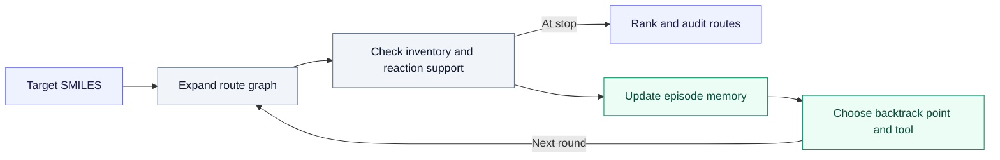

# RetroAgent

**Recursive self-improvement for multistep retrosynthesis**

RetroAgent plans synthesis routes from a target SMILES. It uses **recursive self-improvement (RSI)** during inference. Each round of search produces evidence about which reactions, intermediates, and tools helped. The agent uses that evidence to decide where to backtrack, which tool to call next, and which promising branches to keep.

## The RSI loop



1. **Search.** Build a graph of candidate reactions using specialist retrosynthesis models and retrieved precedents. Verify exact inventory membership, route structure, atom sources, and per-step ChemCensor (CC) support.
2. **Reflect and revise.** Record supported branches, missing precursors, failed reaction centers, and tool outcomes in memory scoped to the current target. The LLM uses those observations to choose a repair point and request a different expansion or propose a local change.
3. **Recheck and rank.** Validate the revised candidates and retain the best route found so far. Both phases share one budget. The first route is ranked by closure tier and CC. For the remaining slots, RetroAgent uses yield coverage and diversity to select among routes close to the best CC in each tier.

## Benchmark

The same 100 targets, chemistry services, and per-target budget ceilings were used for RetroAgent and five local adaptations of published control strategies. The targets were used during method development.

| Metric | **RetroAgent** | ReTRACE-style | RetrOrchestrator-style | LARC-style | RetroPlanner-style | DeepRetro-style |
|---|---:|---:|---:|---:|---:|---:|
| Inventory closure | **99%** | 95% | 98% | 88% | 81% | 87% |
| Strict closure | **80%** | 71% | 67% | 60% | 70% | 59% |
| Mean first-route CC across all 100 targets | **2.6918** | 2.3870 | 2.2223 | 2.2117 | 2.2292 | 2.3250 |
| Mean all-route CC, averaged per target | **2.5164** | 2.2056 | 2.0827 | 1.9953 | 1.9826 | 2.0454 |
| All-route diversity | 0.4439 | 0.4370 | 0.4944 | 0.5242 | 0.5182 | **0.5328** |
| Routes with complete yield evidence | 320 | 589 | 611 | 748 | **1,262** | 623 |
| Mean yield proxy on fully covered routes | 8.04% | 22.08% | 15.76% | 22.93% | 19.05% | **24.89%** |
| Mean specialist model calls per target | 96 | 96 | 96 | 96 | 96 | 96 |
| Mean LLM calls per target | 13.38 | 17.57 | 17.01 | 10.50 | 17.10 | 18.00 |
| Mean search work per target | 10,030.11 | 5,942.98 | 5,850.21 | 6,076.78 | 1,778.09 | 8,046.67 |

Strict closure requires exact inventory closure, a structurally valid route within the depth and size limits, supported atom sources, and positive CC at every step. The yield proxy multiplies estimated step yields across a fully covered route.

[Full results](benchmark/RESULTS.md) · [CSV](benchmark/comparison.csv) · [Protocol](benchmark/PROTOCOL.md) · [Audit summary](benchmark/audit-summary.json)

## Run RetroAgent

Install the controller on Linux with Python 3.12.

```bash
python -m venv .venv
source .venv/bin/activate
python -m pip install -r requirements.txt
```

For a first run, connect the two services and use the workflow mode to check the setup.

```bash
python -m retroagent_langgraph \
  --smiles 'CCOCC' --id example --out runs/example \
  --service /path/to/native-service --cc-service /path/to/cc-service \
  --workflow --no-yield
```

In agent mode, the RSI loop requests `gpt-6.1-sol` with medium reasoning effort through the local Codex CLI. Omit `--workflow` to enable LLM calls. The Linux launcher uses Landlock and needs permission to change file ownership and drop to UID 65534. Use `RETROAGENT_CODEX_BIN` and `RETROAGENT_CODEX_AUTH` to specify the local binary and login file if needed.

For batch inference, pass `--targets` with a JSON array containing `Structure ID` and `SMILES` fields. Use a new output directory for each run. The run exports the candidate routes, measured budget use, and per-target audit. Pass `--config benchmark/config.json` for the recorded limits and `--blocked-targets-csv` to exclude direct exact retrieval for a full benchmark cohort.

<details>
<summary>Services and reference assets</summary>

The controller connects to authenticated local Unix sockets. Each service directory contains a `ready.json` connection manifest.

- **Chemistry service.** `--service` connects to the [resident tool interface](scripts/resident_function_tools_v1.py), which provides specialist predictions, exact inventory, inventory neighbors, and exact reaction retrieval. The benchmark used LocalRetro, RetroChimeraEdit, AiZynthFinder, Graph2Edits, and RetroChimeraDeNovo.
- **Reaction scoring.** `--cc-service` connects to the [ChemCensor server](scripts/resident_ram_cc_v86.py). The server needs PyTorch, ChemCensor 1.2.0, the pinned `ChemCensor-DB-U2-1.0.0.sqlite`, and sufficient shared memory. Start it with `python scripts/resident_ram_cc_v86.py --out /path/to/new-cc-service --workers 4`.
- **Reference assets.** Set `RETROAGENT_ASSETS` to the reference directory or use the default `assets/`. Reaction analog retrieval uses `product_index.sqlite`. Yield reporting uses `train_RC1_contexts.sqlite` and `yield_reference.sqlite` and can be disabled with `--no-yield`.

Model weights, stock and reference databases, benchmark targets, and credentials are supplied separately.

</details>

## Tests

The controller tests use a simulated chemistry backend.

```bash
python -m unittest discover -s tests
```
